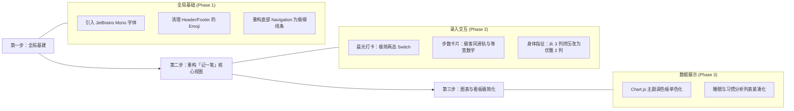

# HealthTrack 极简极客风重构计划与 Claude 专用提示词

> **目标**：彻底消除当前界面的“AI 粗糙感”（滥用 Emoji、五颜六色渐变、浮夸阴影、圆角过大、三列拥挤挤压），以 **JetBrains Mono + 极简黑白灰（Neutral）+ 1px 工业单线美学** 为核心，重构为一个沉稳、耐看、高信息密度的专业健康追踪系统。

---

## 阶段一：设计系统与风格基调（Design Tokens）

| 维度 | 重构前（现状） | 重构后（目标标准） |
| :--- | :--- | :--- |
| **主字体** | 系统默认 sans，无特色 | 正文：`Inter` / `system-ui`；**所有数据与标签**：`JetBrains Mono`（等宽对齐） |
| **图标** | ☀️ 🚶 🌙 📏 📦 ⚙️ 等系统差异巨大的 Emoji | 统一 1.5px 极细线性内联 SVG（Lucide 规范），统一 `text-neutral-500` |
| **色彩体系** | 蓝紫渐变、高饱和黄/绿/红胶囊 | **极简灰阶**：以 `neutral-50` / `neutral-900` 为主，状态只用冷灰与点状指示（Indicator） |
| **轮廓与层次** | `rounded-3xl` + 漂浮阴影（`shadow-2xl`） | **精密单线**：统一 `rounded-xl` + `border border-neutral-200/80`，无浮动大投影 |
| **间距与排版** | 挤迫的三列输入卡片（`grid-cols-3`） | 遵循 8px 网格规范（`p-3.5` / `p-4`，`gap-3`），数据卡片采用 2 列或上下分组 |

---

## 阶段二：三步执行路线（Roadmap）



---

## 阶段三：交付给 Claude 的模块化提示词

为了防止大模型在一次性修改几千行单文件代码时“顾此失彼”或上下文截断，**强烈建议分步让 Claude 执行**：

### 提示词 1：设置设计总规则与 Header / Nav 重构

```markdown
你现在是一名对工业级产品美学有严苛追求的资深 UI/UX 前端专家。
我们正在重构 HealthTrack 项目的前端界面（基于 HTML + Tailwind CSS + 原生 JS）。

【核心美学规范（必须严格遵守）】：
1. 风格定位：Linear / Raycast / Vercel 极简极客风。克制、严谨、单线分割。
2. 字体规则：引入 Google Fonts 的 JetBrains Mono。页面中所有出现的数字、时间、单位、指标对比、代码标签必须强制使用 `font-mono`，且数字开启等宽对齐 `font-feature-settings: "tnum" 1`。
3. 负面清单（绝对禁止）：
   - 严禁使用任何 Emoji 充当 UI 按钮或卡片图标（如 ☀️, 🚶, 🌙, 📏, ⚙️, 📦）。
   - 严禁使用大面积彩色渐变（如 bg-gradient-to-tr from-blue-600 to-indigo-600）。
   - 严禁使用夸张的大圆角（rounded-3xl）与漂浮深投影（shadow-2xl）。
4. 视觉基调：90% 为 Neutral 黑白灰阶。卡片使用 `rounded-xl border border-neutral-200/80 bg-white`，悬停或激活使用 `border-neutral-400` 或微弱背景。图标统一使用 1.5px 极细线性 SVG。

【本次重构任务：全局基建与顶部/底部栏】：
1. 在 <head> 中引入 JetBrains Mono 字体，并提供全局 .font-mono 类。
2. 重构顶部 <header>：
   - 移除蓝紫渐变 HT 方块，改为极简黑底白字或单线圆环 HT 标识。
   - 移除 ⚙️ 和 📦 数据 Emoji，换成规范的 1.5px 极细 SVG 图标与紧凑幽灵按钮（Ghost button）。
3. 重构底部导航栏 <nav>：
   - 移除现有的粗描边与彩色高亮，设计一个具有极简质感的导航栏（未激活项为 text-neutral-400，激活项为 text-neutral-900，图标为 18px 极细 SVG，字号为 text-[10px] font-medium）。

请输出修改后的对应 HTML 代码片段与必要的 CSS 补充。
```

---

### 提示词 2：重构“记一笔 (Log View)”核心录入卡片

```markdown
基于我们已确定的【JetBrains Mono + 极简黑白灰 + 1px 单线美学】规范，现在重构主内容区中的“记一笔 (view-log)”视图。

【当前痛点分析】：
- 当前页面将“睡前体重、晨起空腹、晨起腰围”硬塞在 grid-cols-3 中，手机端极其拥挤。
- 晨光卡片用了黄色色块与 Emoji ☀️；步数滑块质感粗糙。

【重构需求】：
1. 日期切换行：
   - 保留日期选择器与“今日”快捷键，但改为单线药丸样式，日期数字使用 font-mono。
2. 晨光与步数卡片：
   - 重构为精致的 2 列并排卡片（或上下卡片）。
   - 晨光：使用 1.5px 太阳 SVG 图标，配合类似 shadcn 的极简 Segmented Switch（YES / NO 开关），移除 Emoji。
   - 步数：突出 JetBrains Mono 的巨大等宽数字（如 7,420 steps），滑轨改为更精致的极细轨道。
3. 身体指征卡片（体重与腰围）：
   - 废除拥挤的三列布局！将其整合为一个名为【身体指征 / Morning Metrics】的精致大卡片。
   - 内部使用 2 列网格：左侧为“晨起空腹体重”，右侧为“晨起腰围”。
   - 将“睡前体重”独立作为晚间卡片，或放在副级区域，避免不同时段的数据混杂在一起。
   - 输入框样式：去掉粗边框，改为优雅的底边单线（focus 时变黑），输入数字使用 text-2xl font-mono。
   - 对比数值（如 -0.3kg）用极小的字体显示在下方，体现秩序感。

请给出重构后的完整 `<section id="view-log">` HTML 代码，保留原有 JS 交互的 id 与 onclick 绑定，只升级 UI 结构和样式。
```

---

### 提示词 3：Chart.js 图表与看板风格的极简单色化

```markdown
现在针对看板（view-dash）与图表进行【去 AI 味】升级。

【重构原则】：
1. Chart.js 默认生成的彩色折线（红/蓝/绿）往往很刺眼。请指导如何将图表颜色配置改为【单色极简主义】：
   - 线条颜色使用深灰中性色 `#171717`（neutral-900）或冷灰 `#525252`。
   - 填充区域去掉高饱和彩色渐变，改为极淡的中性色渐变或完全无填充。
   - 网格线使用微弱的 `#f5f5f5`，隐藏多余边框。
   - 图表数字刻度与 Tooltip 提示弹窗字体强制绑定 JetBrains Mono。
2. 数据摘要卡片（Summary Cards）：
   - 重构看板顶部的指标汇总，参考 Linear/Stripe 风格：小尺寸标题（text-xs text-neutral-500 uppercase tracking-wider） + JetBrains Mono 大数字 + 细小的涨跌状态微点。

请提供对应的 Tailwind 结构代码和 Chart.js 配置更新说明。
```
